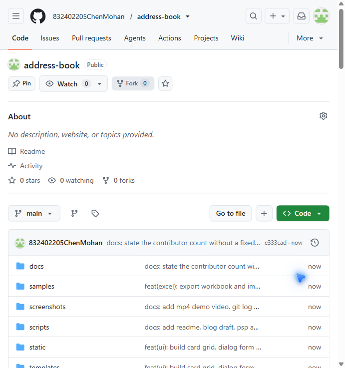
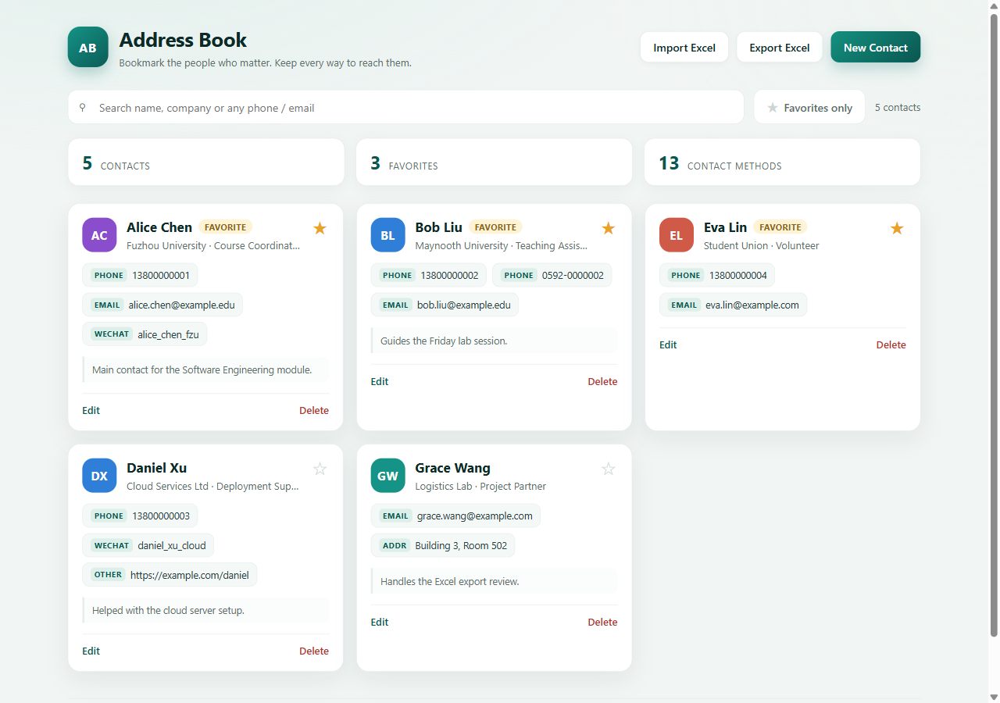
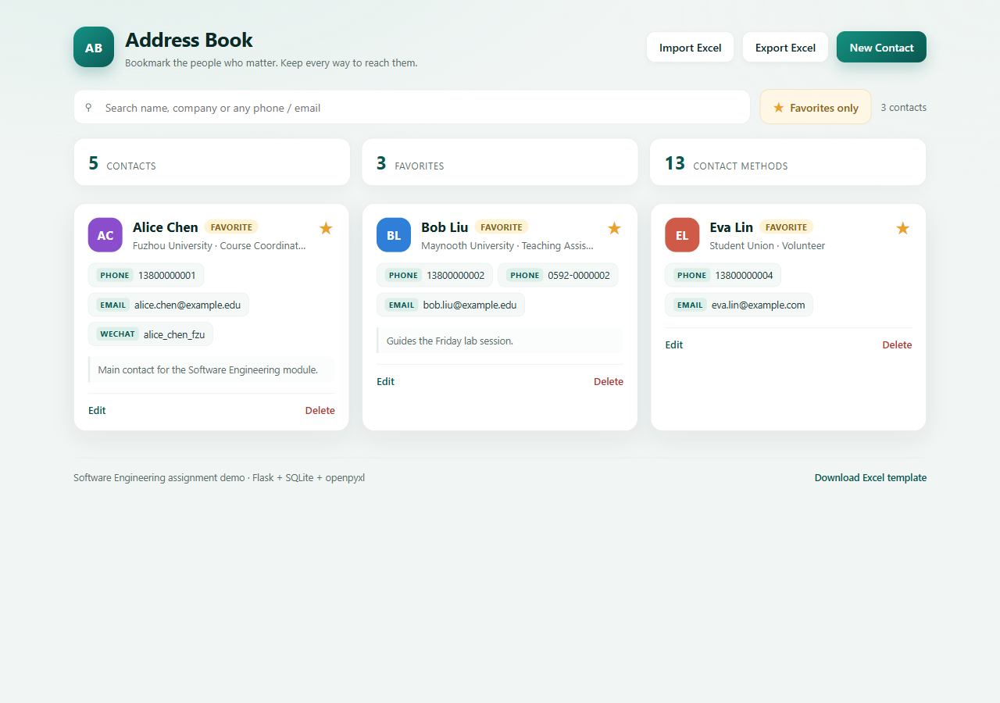
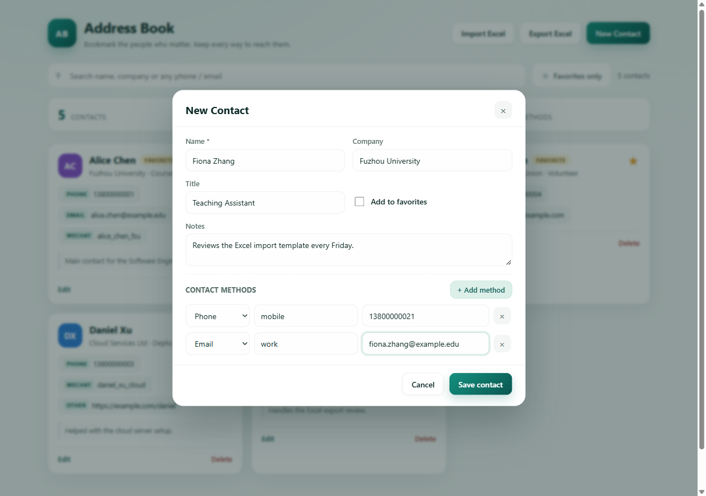
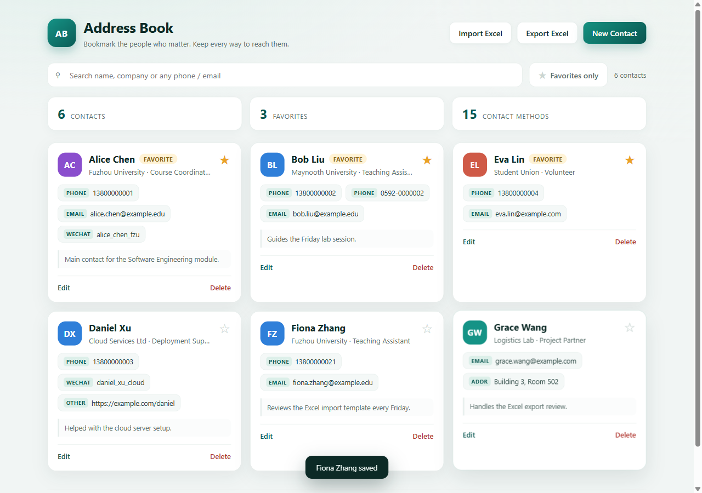
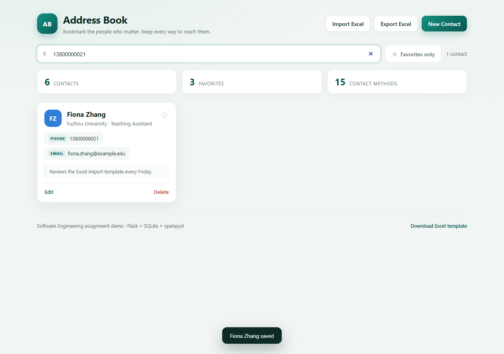
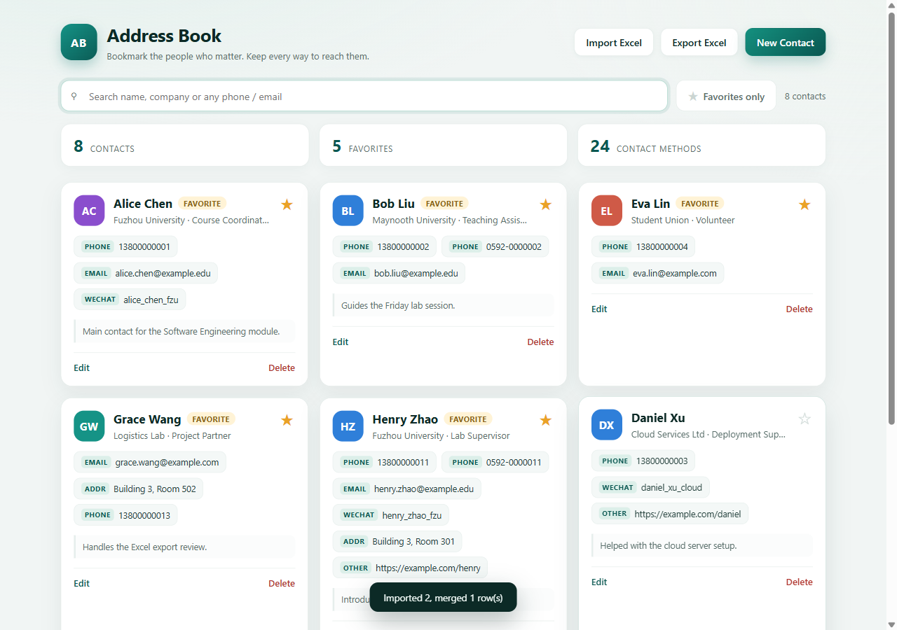

# Extreme Programming Assignment — Address Book (Flask + SQLite + Excel Import/Export)

> Software Engineering 2601 / Fuzhou University – Maynooth University International College · Individual project

## Assignment Information

| Item | Content |
| --- | --- |
| Course for This Assignment | Software Engineering (FZU–MU) |
| Team Name | Individual project (Chen Mohan, student ID: 832402205) |
| Assignment Requirements | Extreme Programming: bookmarked contacts, multiple contact methods for one contact, Excel import and export; optional cloud deployment |
| Objectives of This Assignment | Complete the full cycle — requirement breakdown → design → coding → testing → deployment → documentation — on my own inside a four-day window. The real test is whether each requirement can be turned into a verifiable feature and whether the result can be reproduced, which is why every claim below is backed by an automated test or a screenshot |
| Other References | Repository: https://github.com/832402205ChenMohan/address-book · Code standard: https://github.com/832402205ChenMohan/address-book/blob/main/docs/CODE_STANDARD.md · Flask documentation · openpyxl documentation |

## Contents

1. [Requirement breakdown: turning the brief into acceptance points](#1-requirement-breakdown-turning-the-brief-into-acceptance-points)
2. [Project links](#2-project-links)
3. [Implementation approach](#3-implementation-approach)
4. [Program screenshots](#4-program-screenshots)
5. [Full run video](#5-full-run-video)
6. [Git commit history and commit count](#6-git-commit-history-and-commit-count)
7. [Cloud deployment (optional, bonus)](#7-cloud-deployment-optional-bonus)
8. [PSP table](#8-psp-table)
9. [Problems met during development and how they were solved](#9-problems-met-during-development-and-how-they-were-solved)
10. [Self-check against the grading rubric](#10-self-check-against-the-grading-rubric)

---

## 1. Requirement breakdown: turning the brief into acceptance points

The brief only names the features; it says nothing about interaction details. My approach was to rewrite each requirement as one sentence that could be *verified by a screenshot*, then derive the schema and the API from those sentences. The four features ended up as follows.

| Requirement | Acceptance point I defined |
| --- | --- |
| 1.1 Bookmark contacts (25 points) | Any contact can be marked and unmarked as a favourite; the state is visible at a glance in the list; the list can be filtered down to favourites; the bookmark survives an export to Excel |
| 1.2 Add multiple contact methods (10 points) | One contact can hold at least 3 phone numbers and 2 e-mail addresses, each carrying a label (mobile / office / work); different method kinds are visually distinguished on the card |
| 1.3 Import and export (25 points) | Export must be a real .xlsx: one row per contact, one column per kind of information (`Phone 1` / `Phone 2` …) with a styled header; import must recognise those columns and rebuild the labelled methods; contacts with the same name must not be duplicated |
| 1.4 Web deployment (+15 points) | Reachable through a public IP or domain, not through `localhost` |

There is a trap in this requirement that is easy to miss. The brief says "each type of information should occupy a separate column", but a person may have three phone numbers. Keeping a single `Phone` column loses data; hard-coding three columns leaves empty cells for everyone with one number. I settled on **deciding the column count from the actual data** (see 3.4), which satisfies the literal wording without losing anything.

## 2. Project links

- Repository: https://github.com/832402205ChenMohan/address-book
- Code standard: https://github.com/832402205ChenMohan/address-book/blob/main/docs/CODE_STANDARD.md
- Cloud deployment address: not deployed (optional +15; the deployment guide is in `docs/DEPLOY.md` — once deployed, put the public address here)
- Demo video: see section 5



## 3. Implementation approach

### 3.1 Why the project is layered

The project is only four Python modules plus three front-end files, but the layering is deliberate.

```
Browser (index.html + app.js + style.css)
        |  fetch JSON / multipart
        v
app.py          view layer  : URLs, parameters, JSON and file responses. No SQL.
        |
models.py       domain layer: validation, CRUD, bookmarking, statistics
excel_io.py     file layer  : xlsx read/write. Touches data only through models
        |
database.py     data layer  : SQLite connection, schema, foreign-key pragma
```

Two reasons:

1. **Tests can bypass the browser.** `tests/test_app.py` drives the API through Flask's `test_client`, so 12 cases finish in two seconds with no server and no clicking. The cleaner the split above the view layer, the easier the tests.
2. **Import/export and the page must share one validation rule.** If Excel import had its own validation, data accepted by the page could be rejected on import. So `excel_io` never inserts rows directly; it builds the same payload and hands it to `models.create_contact` / `update_contact`, keeping a single source of truth.

### 3.2 How bookmarking works

`contacts.is_favorite` stores 0/1. There is no separate favourites table — a bookmark is an attribute of a contact, not an entity.

Three parts work together:

- **Ordering:** `ORDER BY is_favorite DESC, name COLLATE NOCASE ASC`. Favourites always come first, alphabetical inside each group, so "easy access" is not only a filter — important people are on screen when the page opens.
- **Filtering:** `GET /api/contacts?favorite=1` adds `is_favorite = 1` to the query; the "Favorites only" button in the UI is a plain boolean.
- **Toggling:** `POST /api/contacts/<id>/favorite` accepts `{"favorite": true/false}`. An explicit value cannot get out of sync on double clicks, while omitting it makes the server invert the current state, which leaves room for a keyboard shortcut later.

The star button deliberately does **not** update optimistically: it waits for the response and calls `loadContacts()` again. A bookmark changes the sort order, so patching the UI locally would make cards jump around and look like a bug. Re-fetching a few dozen rows costs nothing.

### 3.3 Data model for multiple contact methods

This is the only structure in the assignment that needed real design. Kinds and counts are both open-ended, so it is a **one-to-many child table** rather than a handful of columns on the parent.

```sql
CREATE TABLE contact_methods (
    id         INTEGER PRIMARY KEY AUTOINCREMENT,
    contact_id INTEGER NOT NULL,
    kind       TEXT NOT NULL,             -- phone / email / wechat / address / other
    label      TEXT NOT NULL DEFAULT '',  -- mobile / office / work ...
    value      TEXT NOT NULL,
    sort_order INTEGER NOT NULL DEFAULT 0,
    FOREIGN KEY (contact_id) REFERENCES contacts (id) ON DELETE CASCADE
);
```

Specific decisions:

- `kind` is a closed enum of five values. The dropdown can only offer those five and `normalise_payload` validates them again. The chip colours, the Excel column names and the import rules therefore all draw on one enum, so a value selectable in the UI can never become unrecognisable to the importer.
- `label` and `value` are stored separately. `13800000001` and `mobile` are different dimensions: one says how to reach the person, the other says which number this is. Collapsing them into `13800000001 (mobile)` happens only in the Excel layer; the database stays structured.
- `sort_order` keeps the order the user typed, so a refresh does not shuffle the chips.
- `ON DELETE CASCADE` plus `PRAGMA foreign_keys = ON` on the connection means deleting a contact removes its methods automatically, with no double delete in application code.

Updating a contact means **full replacement**: `PUT` deletes every method of that contact and re-inserts from the new payload. The client does not have to diff anything and no stale rows survive. Ids change as a result, but method ids are never exposed, so that costs nothing.

### 3.4 Excel export and import

**Export** (`GET /api/export`):

1. Bucket every contact's methods by `kind` and take the largest count per kind — that is the column width for the kind (at least one column).
2. Header row = `Name, Company, Title, Notes, Favorite` followed by `Phone 1..n`, `Email 1..m`, …
3. One row per contact; the k-th method of a kind goes into the k-th column. A labelled value is written as `13800000001 (mobile)`.
4. openpyxl applies a header fill (`0F766E`), bold white text, thin borders, a frozen header row, an autofilter over the whole sheet, and column widths derived from the headers — so the exported file is presentable without further formatting.

Real export (Alice Chen has two phones and one e-mail, Bob Liu one e-mail):

| Name | Company | Title | Notes | Favorite | Phone 1 | Phone 2 | Email 1 | WeChat 1 | Address 1 | Other 1 |
| --- | --- | --- | --- | --- | --- | --- | --- | --- | --- | --- |
| Alice Chen | Fuzhou University | Course Coordinator | Main contact ... | Yes | 13800000001 (mobile) | 13800000002 (office) | alice@example.edu | | | |
| Bob Liu | Maynooth University | Teaching Assistant | | Yes | | | bob@example.edu | | | |

**Import** (`POST /api/import`):

1. Read the first worksheet with `load_workbook(data_only=True)`. Any parser failure becomes a single 400 "file not readable" message instead of an openpyxl stack trace.
2. Header recognition is regex-based: fixed columns go through an alias table (`Name`, `Bookmark`, `Favorite`, `Starred` are all accepted), while contact columns match `^(phone|email|wechat|address|other)\s*(\d+)?$`, so `Phone`, `Phone 1` and `Phone 2` all resolve.
3. Several values of one kind in a single cell are allowed: `;` or a line break separates them, and `13800000001 (mobile)` is split into value and label.
4. **Merge by name.** If a contact with the same name already exists (`COLLATE NOCASE`), no new row is created. New methods are appended, existing `(kind, value)` pairs are skipped, company / title / notes are filled in only when empty, and the bookmark flag is OR-ed. Without this rule, importing the same file twice doubles the address book.
5. The response is `{"imported": n, "merged": m, "skipped": k}`, which the UI turns into "Imported 2, merged 1 row(s)" — the user can see exactly what happened.
6. A sheet with no recognisable column at all is rejected outright rather than importing zero rows silently, because silent failure is the hardest kind to diagnose.

### 3.5 Page style

"Page style" carries 10 points, so this is a designed interface rather than a default form:

- A brand header plus three actions (Import / Export / New), with the search field and the "Favorites only" toggle on one row.
- A three-cell statistics strip showing contacts, favourites and contact methods, read straight from the API's `stats` instead of being recomputed in the browser.
- Contact cards: initials avatar coloured from a seven-colour palette by a hash of the name (so a person keeps the same colour), a FAVORITE badge, chips tinted per method kind, notes as a quoted block, and Edit / Delete in the card footer.
- The form is a native `<dialog>` opened with `showModal()`, with a blurred backdrop, Esc to close, and method rows that can be added or removed.
- Every action reports its result through a toast, which turns red on failure — nothing fails silently.

### 3.6 Testing

`tests/test_app.py` holds 12 cases, each on its own database under `tmp_path`, so they never interfere.

| Case | What it proves |
| --- | --- |
| `test_index_page_renders` | The page renders the form skeleton |
| `test_create_and_list_contact` | Method count and statistics after creation |
| `test_validation_rejects_empty_name` | An empty name returns 400 |
| `test_favorite_toggle` | The favourite endpoint and `?favorite=1` filtering |
| `test_search_matches_contact_methods` | Searching a phone number and a name both hit |
| `test_update_contact_replaces_methods` | Update really replaces, leaving no stale methods |
| `test_delete_contact` | The list is empty after deletion |
| `test_export_layout_one_row_per_contact_and_one_column_per_type` | Header order, row count, one column per kind |
| `test_import_round_trip` | Export → delete → import restores the data |
| `test_import_merges_existing_contact` | The merge-by-name rule |
| `test_import_skips_rows_without_name` | Rows without a name are skipped and counted |
| `test_import_rejects_unknown_columns` | A sheet without headers fails loudly |

The suite runs in about two seconds and prints `12 passed`, which is why I was comfortable pushing changes without manual re-testing.

## 4. Program screenshots

### 4.1 Home page: card grid, statistics strip, favourite badges



### 4.2 Favourites only (bookmark feature, 25 points)



### 4.3 New contact with several contact methods (10 points)



### 4.4 The list after saving, with the confirmation toast



### 4.5 Searching by phone number (proof that contact methods are real data)



### 4.6 Import result message (import/export, 25 points)



### 4.7 After exporting


> The exported `contacts.xlsx` was checked directly: one header row plus eight contact rows, eleven columns, headers `Name / Company / Title / Notes / Favorite / Phone 1 / Phone 2 / Email 1 / WeChat 1 / Address 1 / Other 1`. Alice Chen's row contains `13800000001 (mobile)` and `alice.chen@example.edu (work)`. The download produced during the recorded run is `screenshots/exported-contacts.xlsx` (a run artefact, not tracked in git).

## 5. Full run video

Recorded in one take, no editing: open the page → bookmark a contact → create a contact with two methods → search by phone number → import an Excel file → export to Excel.

- [demo-run.mp4 (0.44 MB, about 40 s)](https://raw.githubusercontent.com/832402205ChenMohan/address-book/main/screenshots/demo-run.mp4) — the recording used for this submission; it also uploads cleanly into the CSDN editor if an inline player is preferred
- [demo-run.webm (2.8 MB)](https://raw.githubusercontent.com/832402205ChenMohan/address-book/main/screenshots/demo-run.webm) — the original high-quality recording

## 6. Git commit history and commit count


> The screenshot was taken when the history had reached ten commits; two documentation commits ("fill repository links", "refresh git log archive") were added afterwards, so the authoritative list is the `Commits` page: https://github.com/832402205ChenMohan/address-book/commits/main

Every commit on `main` is mine — it is an individual project, so my contribution share is 100%. The commit count is visible in the screenshot above and on the repository's `commits` counter, and the full local log with per-commit file and line counts is archived in `docs/git-log.txt`.

Commits were split by feature rather than pushed in one go:

```
chore: scaffold address book project
feat(db): add sqlite schema and contact model
feat(api): expose contact CRUD and favorite endpoints
feat(ui): build card grid, dialog form and toast feedback
feat(excel): export workbook and import with merge rule
test: cover api behaviour and excel round trip
docs: add readme, blog draft, psp and deployment guide
docs: add mp4 demo video, git log archive and blog placeholders
docs: align blog commit count with repository history
```

## 7. Cloud deployment (optional, bonus)

The deployment procedure is documented in `docs/DEPLOY.md`: Ubuntu 22.04, gunicorn under systemd, nginx reverse-proxying port 80.

> **Status: not deployed** (this section is optional and does not affect the base score). It only needs a public server or a Render/Railway account — no code change is required, because `app.py` already exposes the `app` object, so `gunicorn app:app` starts the service directly. Once deployed, put the public address in section 2 and add a screenshot whose address bar shows the public IP or domain as `screenshots/09-cloud-deploy.png`.

Deployment address: not deployed (`localhost` / `127.0.0.1` does not count — it must be a public IP or domain).

## 8. PSP table

| PSP 2.1 | Personal software process | Estimated (min) | Actual (min) |
| --- | --- | --- | --- |
| **Planning** | **Planning** | **20** | **15** |
| · Estimate | How long will this take? | 20 | 15 |
| **Development** | **Development** | **155** | **168** |
| · Analysis | Requirement analysis (four acceptance points) | 15 | 12 |
| · Design Spec | Design document (schema and API table) | 10 | 8 |
| · Design Review | Design review (column layout, merge rule) | 5 | 5 |
| · Coding Standard | Coding standard (layering and naming) | 5 | 6 |
| · Design | Detailed design (page blocks and interaction flow) | 15 | 14 |
| · Coding | Coding (four backend modules, three front-end files) | 90 | 105 |
| · Code Review | Code review (reading my own diff) | 10 | 8 |
| · Test | Testing (12 cases, all green) | 15 | 10 |
| **Reporting** | **Reporting** | **25** | **32** |
| · Test Report | Test report (screenshots and case table) | 10 | 8 |
| · Size Measurement | Size measurement (lines and modules) | 5 | 4 |
| · Postmortem | Postmortem and improvement plan | 10 | 20 |
| **Total** | **Total** | **200** | **215** |

Measured size: about 800 lines of Python across five modules (350 of them tests), about 700 lines across the three front-end files, and four documents.

## 9. Problems met during development and how they were solved

1. **How many Excel columns?** My first plan was a fixed `Phone 1..3`. That leaves three empty columns for anyone with one number, and loses data for anyone with four. I switched to computing the width from the data (at least one column per kind) and to a `Phone N` regex on the import side, so both directions agree.
2. **Repeated imports created duplicate contacts.** The first implementation inserted blindly, so importing the same file twice doubled the address book. Merge-by-name (`COLLATE NOCASE` plus `(kind, value)` de-duplication) made repeated import idempotent, which also covers the case of merging two exported files.
3. **Concurrent writes between Flask and SQLite.** With `debug=True`, the reloader's two processes occasionally raised `database is locked`. The fix: one connection per request, closed immediately (no global connection), and `debug=False` for demos and deployment. In production gunicorn's workers handle it, and the write volume here is tiny.
4. **Full-replacement update broke the foreign key.** My first version inserted the new methods before deleting the old ones inside the same transaction, so the list briefly showed two generations of methods for one contact. Deleting first and inserting second, both inside one `with connection:` block, makes a wrong statement order fail immediately instead of leaving dirty rows.
5. **Excel encoding worries.** I expected trouble with non-ASCII text in xlsx, but openpyxl is UTF-8 throughout and round-trips fine. The format that genuinely needs care is CSV (BOM and delimiter issues), which is exactly why this project deliberately supports xlsx only.

## 10. Self-check against the grading rubric

| Grading item | Points | Self-check |
| --- | --- | --- |
| Blog formatted in Markdown | 10 (basic requirements) | Contents list, tables, code blocks, screenshots |
| GitHub repository link / code standard link | same block | Repository public; code standard at `docs/CODE_STANDARD.md` |
| Description of implementation ideas | 20 (basic requirements) | Section 3 explains *why* each design decision was made, with schema, endpoints and edge rules |
| Program screenshots | same block | Seven run screenshots plus the repository overview and commit history |
| Page style | 10 | Card grid, statistics strip, dialog form, toasts — no stock theme |
| Bookmark contacts | 25 | Star toggle, FAVORITE badge, favourites-only filter, favourites sorted first, preserved on export |
| Multiple contact methods | 10 | Five-kind enum, free labels, one-to-many child table, tinted chips |
| Import and export | 25 | Dynamic column widths, styled header, regex headers, merge by name, skip nameless rows, explicit errors |
| Cloud deployment (optional) | +15 | See section 7 (not deployed) |
| At least 3 commits | hard requirement | See section 6 |
